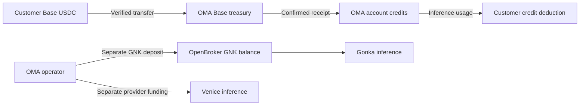

# Pricing, model operations and treasury

Verified 7 October 2026. Prices below are USD per million tokens unless stated otherwise. Market conversion is an estimate, not an invoice or realized profit.

## Customer pricing and costs

| Route | Customer input | Customer output | Cost basis |
| --- | ---: | ---: | --- |
| Gonka through OpenBroker | $0.02 | $0.02 | Estimated $0.0033 per million total tokens at $0.22/GNK |
| Venice | Provider input × 1.5 | Provider output × 1.5 | Venice's current published USD catalog; long-context tiers apply |

OpenBroker charges **10 ngonka per token per attempt**. Its pricing guide suggests **15 ngonka per token** as a planning estimate including a 1.5× retry factor. One GNK contains one billion ngonka, so one million total tokens typically costs 0.015 GNK. At the rounded $0.22/GNK reference used in the catalog, that is $0.0033. Multiplying by six (500% markup) gives $0.0198; the configured customer rate is the requested rounded **$0.02**. One million input plus one million output costs the customer $0.04.

This implies an estimated 83.5% gross margin before hosting, facilitator gas, payment fees, free chat, unsuccessful attempts and acquisition costs. It is not net profit. Venice's 50% markup produces a 33.3% gross margin before those costs. The admin display now divides estimated markup by customer revenue, not provider cost.

Do not use the older governance parameter of 1 ngonka/token to budget OpenBroker. The live DevShard parameter and OpenBroker pricing are 10 ngonka/token/attempt. Do not describe a price as “1,000% cheaper”: a price cannot fall by more than 100%. Comparisons with direct DeepSeek also involve different model versions and peak/off-peak pricing.

The curated registry is `server/src/inference/model-catalog.json`, shared with the frontend. Billing and `/v1/models` resolve the same final admin overrides. Provider estimates are stored separately from customer overrides. Long-context Venice rates apply to the whole request above the published prompt threshold and appear under `pricing.extended`.

## Three separate pools of money

The configured public Base recipient reported by `/x402/info` is **`0x3144293aacc1c26eb803591151d775ed89eefcfe`**. This audit verifies configuration, not custody of its private key. The asset is native Base USDC, **`0x833589fCD6eDb6E08f4c7C32D4f71b54bdA02913`**, six decimals, chain 8453. Do not send GNK or other assets to that address expecting OpenBroker credit.

At the audit snapshot this address held 0 USDC and 0 ETH. That does not establish the balance of the separate facilitator wallet or any other OMA wallet.

The treasury receives payment. A facilitator signing wallet, when configured, pays Base ETH gas to submit the customer's EIP-3009 authorization. It can be a different address. The API server does not need the treasury's private key to receive USDC. It does need the appropriate facilitator configuration to submit gasless payments. Receipt confirmation, recipient/asset/amount checks and durable idempotent credit records precede account crediting. Replaying a payment cannot grant new credits or credit a different user.

OpenBroker uses its own account-specific **Gonka deposit address** and GNK balance; its guide describes a 100 GNK activation deposit. There is no automatic conversion of treasury USDC to GNK in this repository. Venice funding is also independent. Customer credits are an internal USD ledger, not a wallet balance or a guarantee that upstream accounts are funded.

## RPC resilience

Both browser wallet calls and backend reads/settlement now try configured endpoints followed by `https://mainnet.base.org` and `https://base-rpc.publicnode.com`. Both public endpoints returned Base chain ID `0x2105` during this audit. The previously listed Llama endpoint returned HTML and was removed. Base Sepolia uses its own separate endpoints.

Each RPC attempt has a five-second timeout. The wallet proxy does not retry a valid contract error or a partially successful batch. Dedicated URLs stay on the server. The connected QuickNode Base and Solana endpoints were suspended when inspected; public failover avoids making them a single point of failure. Free services still have rate limits and outages: fallback improves availability, but cannot guarantee it.

## Model quality, tool calls and limits

The live OpenBroker catalog lists MiniMax M2.7, DeepSeek V4 Flash 0731 and GLM-5.3 Flash. Synthetic coding, tool-call and tool-result conversations were sent through the production OMA API for MiniMax and GLM. Both returned tool calls and accepted tool results. Some responses exposed inline reasoning, duplicate tool calls or stray control text; applications must validate tool arguments and decide whether to execute them. No model-generated code or tool operation was executed by the audit.

DeepSeek's route is paused after repeated unusable output. Venice's `mistral-small-2603` is paused because it is missing from the current provider catalog. A successful HTTP response alone is not a quality check. Re-enable paused models only after plain text, coding, streaming and tool round-trip checks pass against the actual upstream.

Gonka routes currently have an **OMA output cap of 16,384 tokens**, not a claim about an independently verified upstream maximum. The catalog publishes model-specific context, maximum output and default output. OMA validates estimated input plus requested output before sending a request; the upstream tokenizer remains authoritative. Follow-up MiniMax and GLM coding tests with a 1,024-token budget both returned a complete function and finish_reason=stop. Reasoning consumes output budget: a 150–180 token example can finish before producing an answer. API examples now use 1,024 tokens.

OMA's account/key rate limits are separate from provider limits. OpenBroker describes shared gateway capacity and concurrency-related 429s, not a guaranteed per-key quota. Start at one or two concurrent requests, back off in seconds with jitter, and honor Retry-After. Do not claim the model context window is a throughput allowance. OMA provider header deadlines are 60 seconds for non-streaming and 120 seconds for streaming; this is shorter than OpenBroker's documented worst-case request duration. Hosting/proxy limits also apply.

## Operations and reconciliation

1. Monitor treasury USDC, facilitator ETH, OpenBroker GNK and Venice credit separately. Never infer one from another.
2. Record OpenBroker completion/request IDs and reconcile `/v1/usage/{id}` `cost_ngonka` and `cost_source` against the account ledger. Streaming requests ask for the final provider usage chunk. When it is absent, fallback token estimates are independent of SSE chunk boundaries and count content, reasoning and tool-call arguments. Current OMA admin costs are catalog estimates, not a full upstream invoice reconciliation. Signed-in free and aborted requests now retain estimated provider costs with zero customer revenue; anonymous guest usage is still tracked outside the user usage ledger.
3. Refresh Venice catalog prices and output/context limits before releases. Preserve long-context tiers. Review admin overrides when costs change.
4. Re-run payment replay, amount-forgery, finality, cross-account and database credit tests for payment changes. Local fixture transfers do not prove a real funded mainnet settlement.
5. Keep public endpoint failures observable without logging private RPC URLs or API keys. Restore a dedicated endpoint if traffic outgrows public capacity.

## Sources

- [OpenBroker documentation](https://openbroker.gonka.gg/docs), [pricing](https://openbroker.gonka.gg/docs/pricing), [FAQ](https://openbroker.gonka.gg/docs/faq), [load/concurrency](https://openbroker.gonka.gg/docs/load), [chat completions](https://openbroker.gonka.gg/docs/chat-completions).
- [Gonka chain parameters](https://rpc.gonka.gg/chain-api/productscience/inference/inference/params).
- [Venice live model catalog](https://api.venice.ai/api/v1/models).
- [DeepSeek direct pricing](https://api-docs.deepseek.com/quick_start/pricing/) — different model/version and pricing periods; not a like-for-like quote.

## Dependency review

Direct packages were refreshed and the Polar SDK integration migrated to its versioned client. TypeScript stays on 6.0.3 because the current ESLint TypeScript parser does not support TypeScript 7. Vulnerable transitive esbuild and KaTeX versions are overridden through pnpm's supported configuration. The latest `braces` 3.0.3 has an unresolved advisory in the Next lint-tool dependency chain; no patched release was available. Do not feed untrusted glob patterns into that tooling.
